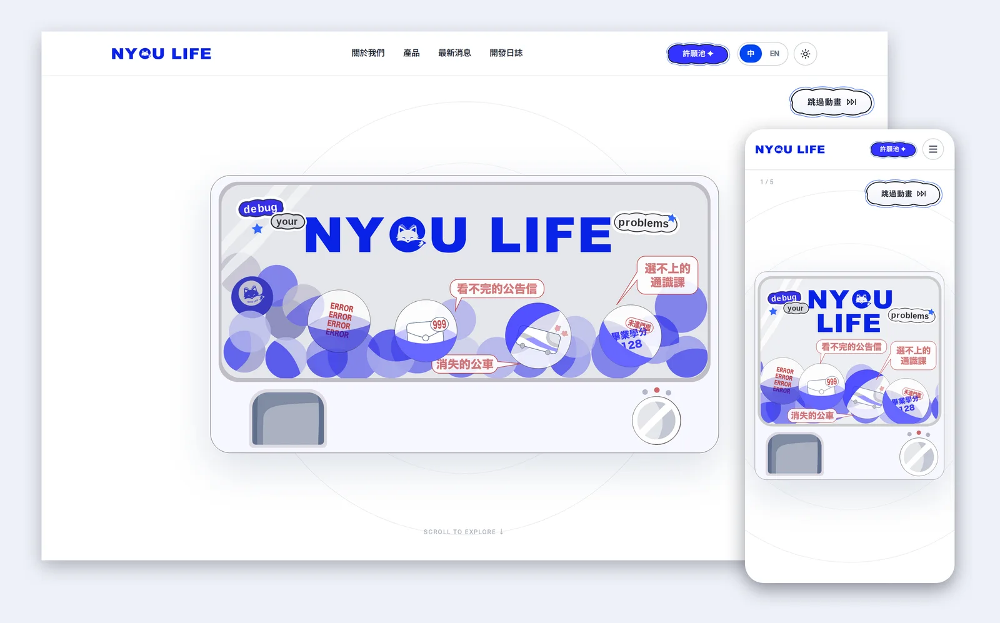
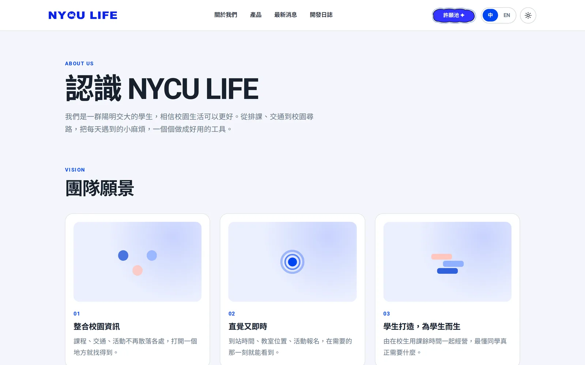
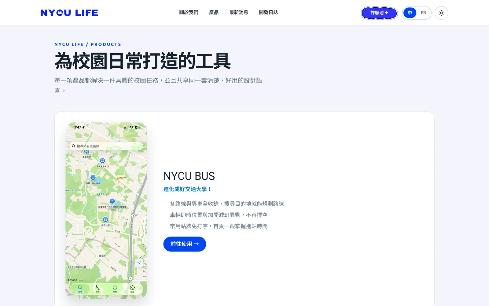
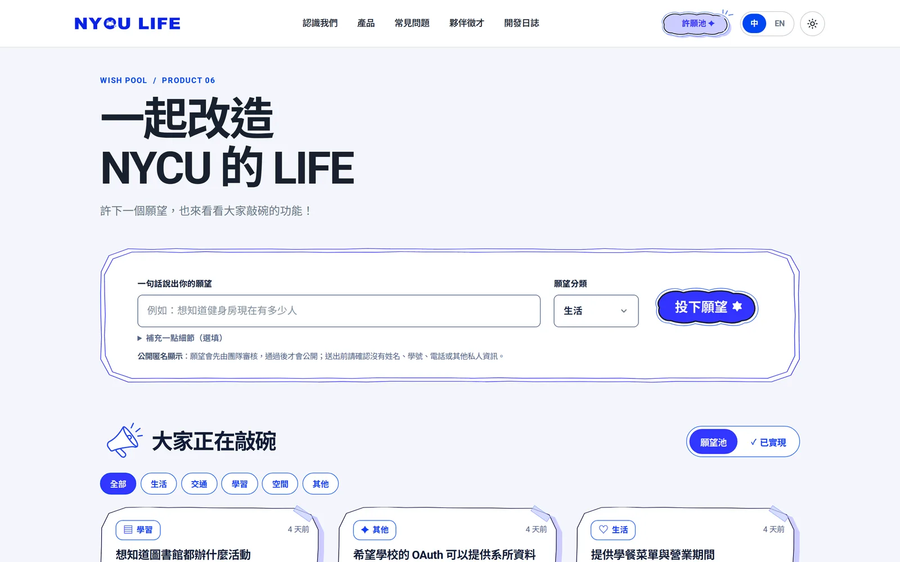
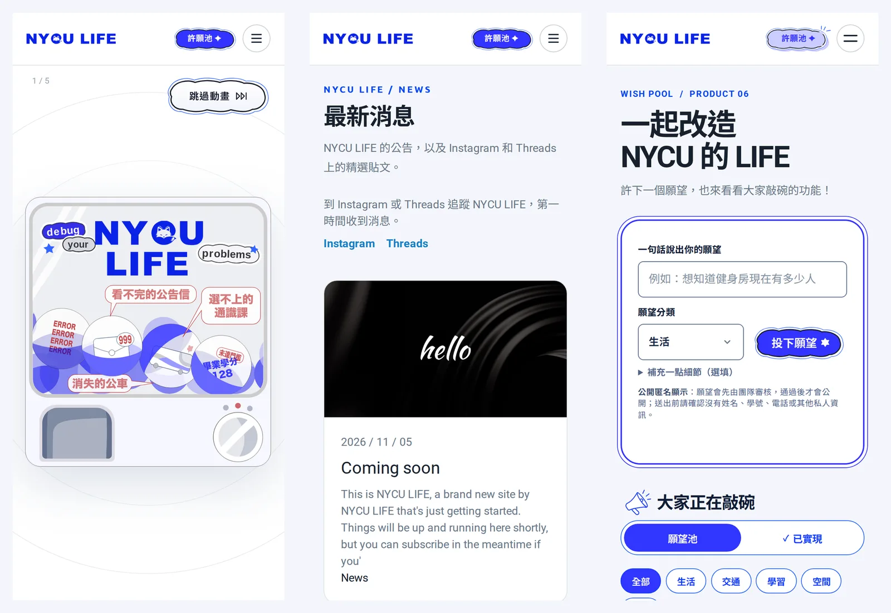
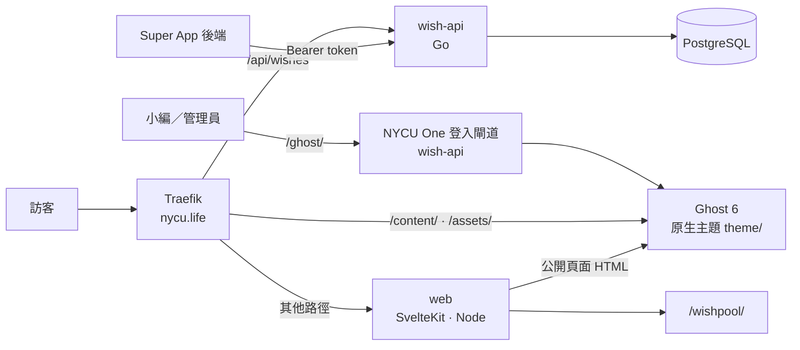

<p align="center">
  <picture>
    <source media="(prefers-color-scheme: dark)" srcset="static/brand/logo-horizontal-white.svg">
    
  </picture>
</p>

<h1 align="center">Debug your campus life.</h1>

<p align="center">
  NYCU LIFE 官網：介紹陽明交大學生團隊打造的校園 App，並收集同學的許願。<br>
  小編在 Ghost 編輯、發布後立刻上線；許願池由獨立的 Go API 負責。
</p>

<p align="center">
  <a href="https://github.com/nycu-life/landing/actions/workflows/ci.yml"></a>
  <a href="https://github.com/nycu-life/landing/actions/workflows/docker.yml"></a>
  <a href="package.json"></a>
  <a href="api/go.mod"></a>
  <a href="docs/ghost-theme.md"></a>
</p>

<p align="center">
  <a href="https://nycu.life/"><b>nycu.life</b></a> ·
  <a href="#快速開始">快速開始</a> ·
  <a href="#部署">部署</a> ·
  <a href="#文件">文件</a> ·
  <a href="https://nycu.life/wishpool/">許願池</a> ·
  <a href="#參與開發">參與開發</a>
</p>

<p align="center">
  
</p>

官網的公開頁面全部由 Ghost 原生主題（`theme/`）直接輸出。小編不用碰程式碼，
**改完按 Publish 就上線，不需要重新建置或部署。** 許願池與它的 API 則留在
SvelteKit 與 Go，跟 CMS 互不影響。

## 功能

### 首頁與關於我們

首頁是可捲動的扭蛋機故事（hero、關於、產品、FAQ、夥伴徵才）。「關於我們」有團隊
願景、形象影片和一路走來的 Milestone。卡片、影片、里程碑都是 Ghost Pages，
新增一筆就多一張卡片。

<p align="center"></p>

### 產品

NYCU BUS、NYCozU、NYCU EVENTS、NYCU MAPS 等產品各有截圖、介紹與連結，也可以額外放一張深色模式用的截圖。
首頁的產品區與 `/products/` 讀同一份 Ghost 資料。

<p align="center"></p>

### 最新消息、開發日誌、漫畫

- **最新消息**（`/news/`）：一般公告，以及 Instagram／Threads 貼文。在 Ghost 新文章裡只貼一行貼文網址，網站就會顯示官方嵌入，不需要任何 Meta 權杖。
- **開發日誌**（`/devlog/`）與**漫畫專區**（`/comics/`）：用 `#devlog`、`#comics` 標籤分類。

### 許願池

匿名許願、+1、分類篩選。新願望先進審核，管理員用 NYCU One 登入後台後公開、
標記已實現並回覆。Super App 可以透過服務帳號讀寫，使用者也能查看、編輯和撤回自己的許願。

<p align="center"></p>

### 手機、雙語、深色模式

<p align="center"></p>

中文是預設語言（`/`），英文版（`/en/`）只涵蓋首頁、關於我們和產品；文章只寫中文。
每個頁面都有淺色與深色兩種外觀。

<sub>截圖取自正式站 <code>nycu.life</code>（2026 年 11 月）。</sub>

## 誰在哪裡改什麼

| 想改的東西                                 | 在哪裡改                                                      | 需要部署嗎       |
| ------------------------------------------ | ------------------------------------------------------------- | ---------------- |
| 文章、公告、IG／Threads 貼文               | Ghost → Posts                                                 | 不用，發布即上線 |
| 首頁文案、產品、FAQ、徵才、願景、Milestone | Ghost → Pages（見 [整站內容速查](docs/site-content.md)）      | 不用             |
| 上方選單                                   | Ghost → Settings → Navigation（Primary 中文、Secondary 英文） | 不用             |
| 版面、樣式、動畫                           | `theme/`，再安裝佈景主題                                      | 需安裝佈景主題   |
| 許願池畫面                                 | `src/`（SvelteKit）                                           | 發版             |
| 許願池 API、審核、Super App 串接           | `api/`（Go）                                                  | 發版             |

## 架構



- **web**：SvelteKit（adapter-node）。`PUBLIC_SITE_ENGINE=ghost` 時把公開頁面轉給 Ghost 主題，自己只負責許願池、健康檢查和舊網址的 308／410。
- **Ghost**：內容與佈景主題。`docker/ghost/` 打包了 NYCU One SSO adapter，成員用學校帳號就能登入後台。
- **wish-api**：許願池 API、審核後台、CMS 登入閘道。

## 快速開始

需要 **Node 24**、**pnpm 10.21**、**Go 1.26** 和 **Docker**。

```bash
git clone https://github.com/nycu-life/landing.git
cd landing
pnpm install
pnpm dev                     # http://localhost:5173
```

沒有設定 Ghost 時，開發伺服器使用預設文案。要接上本機 Ghost：

```bash
docker compose -f docker/ghost/compose.yml up -d --wait
GHOST_OWNER_PASSWORD='choose-a-long-one' node docker/ghost/seed.mjs   # 寫入 .env.ghost.local
GHOST_ADMIN_URL=http://127.0.0.1:2368 node --env-file=.env.ghost.local scripts/seed-site-content.mjs --apply
```

佈景主題、許願池 API 和 Postgres 一起跑的完整環境見 [本機完整預覽](docs/preview.md)。

## 測試

```bash
pnpm check                   # svelte-check 型別檢查
pnpm lint                    # Prettier + ESLint
pnpm test:unit -- --run      # Vitest
pnpm test:e2e                # Playwright（含 SEO 與視覺驗收矩陣）
pnpm cms:theme-build && pnpm cms:theme-check   # 建置並用 gscan 驗證佈景主題
(cd api && go test ./...)    # 許願池 API
```

CI 會在每個 PR 跑以上檢查，全部通過才能合併。介面改動另外要在瀏覽器裡檢查
中英文 × 淺深色 × 桌機／平板／手機共 12 種組合，見 [AGENTS.md](AGENTS.md)。

## 部署

1. 合併到 `main`，打上版本標籤（例如 `v0.0.29`）。GitHub Actions 會建置並推送 `web`、`wish-api`、`ghost` 三個映像到 Harbor。
2. 在 [`nycu-life/k8s-manifests`](https://github.com/nycu-life/k8s-manifests) 的 `apps/landing/overlays/prod/kustomization.yaml` 更新 `newTag`，ArgoCD 會自動同步。
3. 佈景主題有改動時，安裝到正式 Ghost（會先備份舊主題與 routes）：

```bash
pnpm cms:theme-build
GHOST_ADMIN_URL=https://nycu.life GHOST_ADMIN_SESSION_FILE=<0600 session 檔> \
  node scripts/install-ghost-theme.mjs --apply
```

密鑰一律放在 OpenBao，透過 ExternalSecret 注入，不進 Git。切換、驗證和回滾流程見
[Ghost 原生主題](docs/ghost-theme.md)。

## 常見問題

**小編要怎麼把 IG 貼文放上網站？** 在 Ghost 新增文章，內文只貼一行 Instagram 或
Threads 貼文網址，發布即可。只支援公開帳號的公開貼文。

**為什麼英文版沒有文章？** 團隊不會為每篇文章寫兩種語言，所以 `/en/devlog/` 等網址
會轉到中文原文。

**許願池是匿名的嗎？** 公開頁面不顯示任何身分。瀏覽器用簽章 cookie 防止重複 +1
和洗版，Super App 則傳雜湊過的使用者 id。

**Super App 要怎麼串接許願池？** 從後端用服務 token 呼叫，詳見
[許願池文件](docs/wish-pool.md#service-bff-access)。

**改壞了怎麼辦？** Ghost 內容可以在後台還原舊版本；佈景主題安裝前會自動備份到
`.ghost-theme-backups/`；程式則把 `newTag` 改回上一版即可。

## 文件

| 主題     | 文件                                                                   |
| -------- | ---------------------------------------------------------------------- |
| 編輯內容 | [整站內容速查](docs/site-content.md) · [Ghost 編輯慣例](docs/ghost.md) |
| 佈景主題 | [Ghost 原生主題](docs/ghost-theme.md)                                  |
| 許願池   | [產品行為、審核、Super App API](docs/wish-pool.md)                     |
| 開發環境 | [本機完整預覽](docs/preview.md) · [AGENTS.md](AGENTS.md)               |
| SEO      | [可索引頁面與退役網址](docs/seo.md)                                    |

## 參與開發

先讀 [AGENTS.md](AGENTS.md)（技術棧、設計 token、視覺驗收規則）。中文文案依照
[中文文案排版](docs/site-content.md#中文文案排版)，所有改動透過 PR 合併。問題與想法請開 [issue](https://github.com/nycu-life/landing/issues)，
或直接到 [許願池](https://nycu.life/wishpool/) 許願。

## 授權

目前尚未指定授權條款（repo 中沒有 `LICENSE` 檔）。
